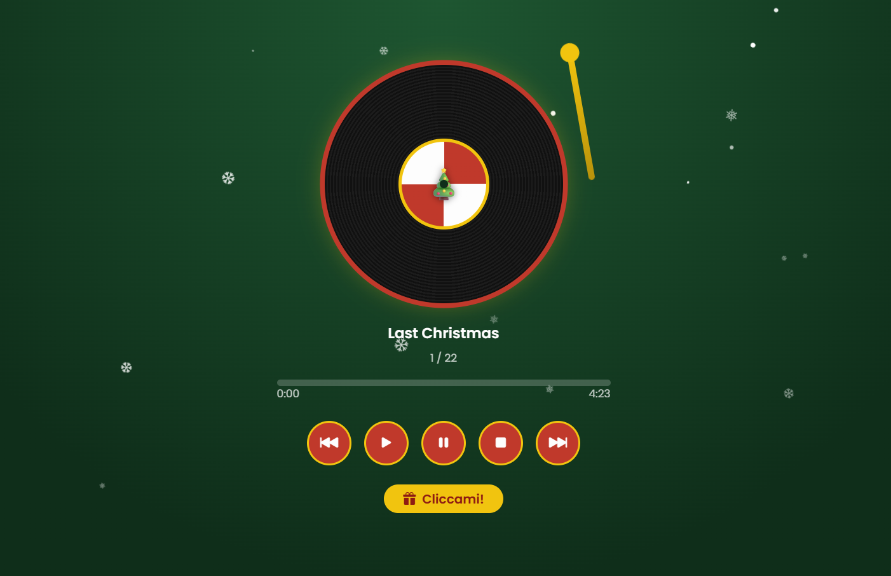

# Christmas Spinner

Un lettore musicale natalizio a forma di giradischi: un vinile che gira a ritmo di musica, la neve che cade e una sorpresa da scoprire.

**[Guarda la demo](https://christmasspinner.vercel.app)**



## Funzionalità

- Disco in vinile che gira durante la riproduzione
- Controlli: play, pausa, stop, traccia precedente e successiva
- Riproduzione in ordine casuale, senza ripetizioni fino alla fine della playlist
- Barra di avanzamento cliccabile
- Neve animata e un messaggio di auguri a sorpresa
- Layout responsive

## Tecnologie

HTML · CSS · Bootstrap 5 · JavaScript

## Scaricalo e personalizzalo

Il progetto è libero da scaricare e adattare come vuoi.

1. Scarica il progetto (**Code → Download ZIP**) oppure clonalo:
   ```bash
   git clone https://github.com/JennyPersichini/christmas_spinner.git
   ```
2. Crea la cartella `song/` e inserisci i tuoi file `.mp3`
3. In `main.js` aggiorna l'array `playlist` con i tuoi brani:
   ```js
   { title: "Titolo della canzone", file: "nome-del-file.mp3" },
   ```
4. Apri `index.html` nel browser

Per cambiare i colori modifica le variabili all'inizio di `style.css` (`--rosso`, `--verde`, `--oro`).

> I brani musicali non sono inclusi nel repository: usa canzoni di cui possiedi i diritti oppure brani liberi da copyright.

## Autrice

**Jenny Persichini** · Web Designer 

Codice rilasciato con licenza [MIT](LICENSE). I brani musicali restano dei rispettivi autori.
